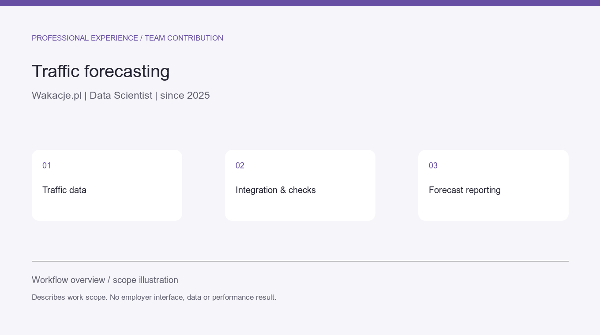
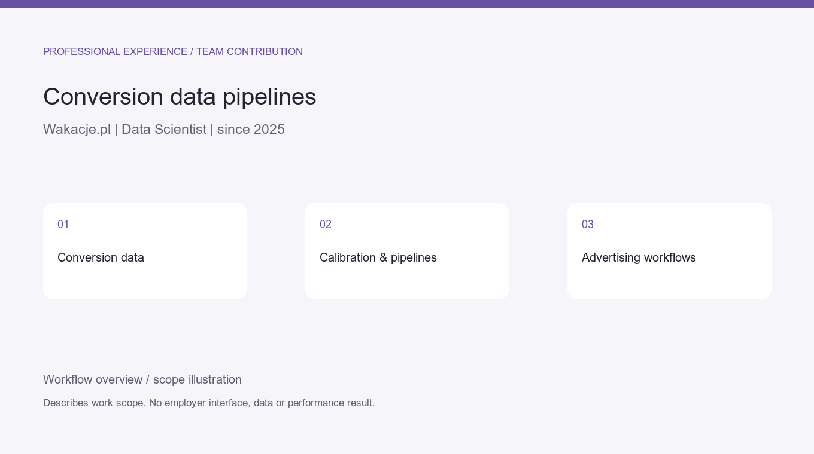
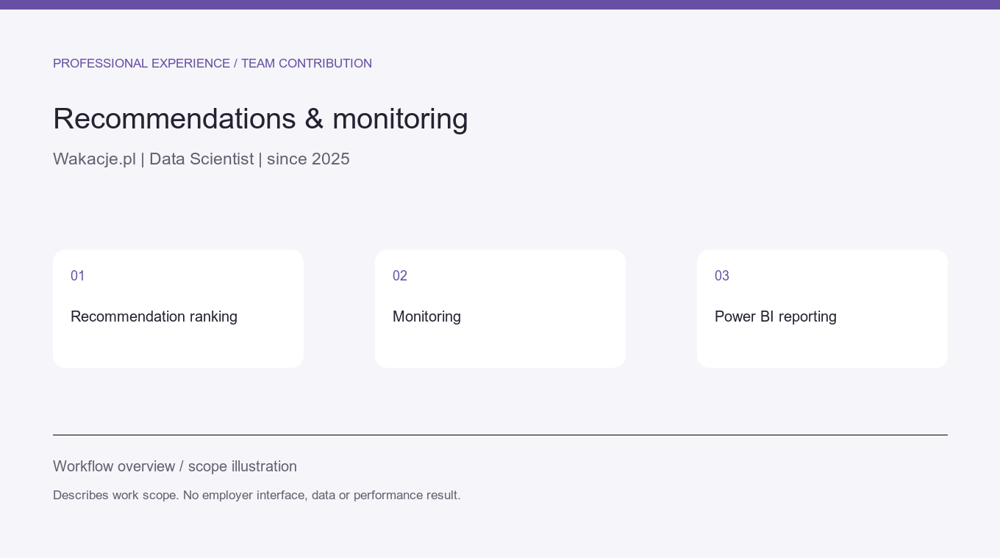
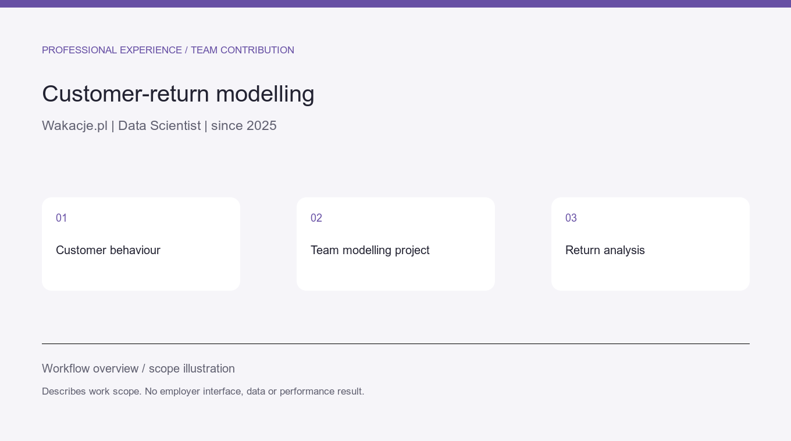
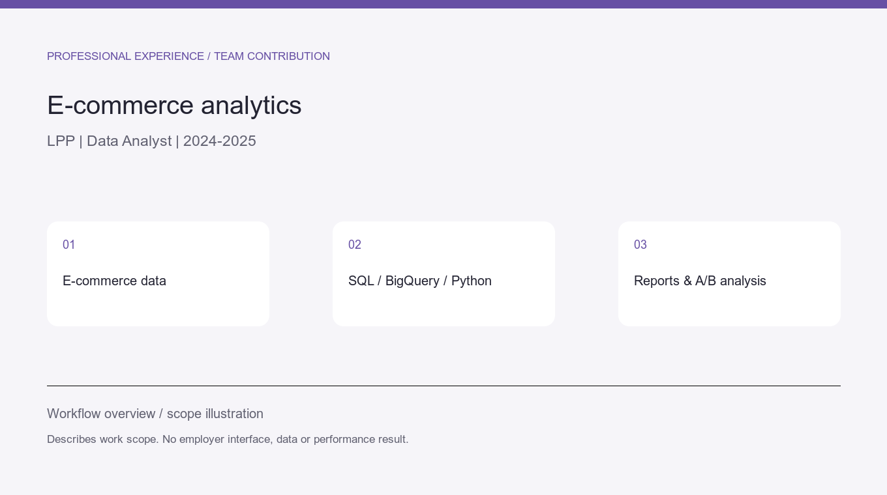
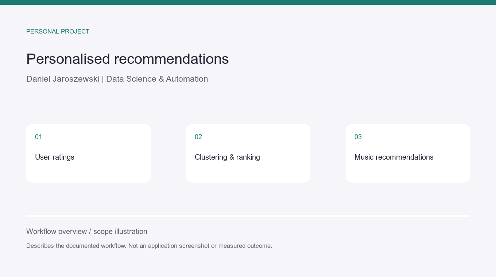
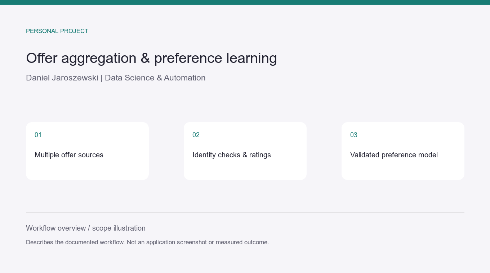

# Daniel Jaroszewski

Data Scientist at Wakacje.pl, previously Data Analyst at LPP. I work on analytics,
forecasting, recommendations, data pipelines and automation using Python, SQL and GCP.

I help turn a business question into checked data, an analysis, a model-evaluation
workflow or a repeatable tool. Projects can start with one report, integration or
defined analytical task. Availability: **5–10 hours per week**.

## Professional work

These entries describe my contribution to employer-owned team projects. They present
the business application and my scope; personal projects below provide separate examples.

### Wakacje.pl — traffic forecasting

Work in the traffic-forecasting project: data integration, table maintenance and Google Sheets exports.

[Read the scope and relevant client applications](case-studies/professional-experience.md#wakacjepl-forecasting).

### Wakacje.pl — conversion models and data pipelines

Conversion-value pipelines, calibration, ingestion repairs and workflow maintenance supporting advertising processes.

[Read the scope and relevant client applications](case-studies/professional-experience.md#wakacjepl-conversion).

### Wakacje.pl — recommendations and monitoring

Work on offer recommendations and ranking, monitoring and Power BI reporting.

[Read the scope and relevant client applications](case-studies/professional-experience.md#wakacjepl-recommendations).

### Wakacje.pl — customer-return modelling

Participation in a team project on customer-return modelling; no sole model authorship or unsupported result is claimed.

[Read the scope and relevant client applications](case-studies/professional-experience.md#wakacjepl-customer-return).

### LPP — e-commerce analytics

E-commerce sales, inventory, returns, costs and profitability reporting; BigQuery/GCP, Python, Looker, GA4 funnels and A/B tests.

[Read the scope and relevant client applications](case-studies/professional-experience.md#lpp).

## Personal applications

### Flat Hunter — listing monitoring and history

Collect and deduplicate listings, retain price changes, inspect cost assumptions and review a ranked shortlist. The case study contains actual application screenshots on fictional data.

[See the workflow, evidence and limits](case-studies/flat-hunter.md).

### Deal Hunter — document extraction and offer research

Extract native HTML/PDF/XLSX/DOCX information, preserve source locations, track asking-price history and produce an evidence-linked review report.

[See the workflow, evidence and limits](case-studies/deal-hunter.md).

### ksiegowy-ai — document automation

Parse invoice XML, JPK and bank CSV exports, produce repeatable reports and review local OCR output. Public code and an executed synthetic CSV example are available.

[See the workflow, evidence and limits](case-studies/document-automation.md).

### Playlist Recommender — personalised recommendations

A Flask application combining user ratings, feature preparation, duplicate handling, clustering and diversity-aware ranking. Public code is available.

[See the workflow, evidence and limits](case-studies/recommendations.md).

### Career Hub — aggregation and preference learning

A local multi-source offer inbox with source-identity checks, snapshot-bound owner ratings, temporal model validation and versioned application materials.

[See the workflow, evidence and limits](case-studies/career-hub.md).

## Research and workflow prototypes

- [Data Journalism](case-studies/data-journalism.md): primary-source research, claims-to-sources tables, charts and editorial drafts. The end-to-end pilot remains pending.
- [Market-data research](case-studies/market-research.md): an experimental pipeline with backtesting, a baseline and outcome tracking. No investment-performance claim.

## Additional public projects and executed examples

- [Agent Relay](https://github.com/ahZe667/agent-relay): a coursework FastAPI/SQLite task-delivery service with authentication, leased claims and retries.
- [Household Chores](https://github.com/ahZe667/household-chores): a coursework Django application for shared household tasks.
- [LeagueTable](https://github.com/ahZe667/leaguetable): a coursework sports-scoreboard application.
- [CSV reporting example](case-studies/report-data.md): an executed, synthetic order/customer join with a duplicate check and CSV/JSON output.

## Working together

We agree on the data sources, expected output and acceptance checks. Delivery includes
the result and instructions for running it again. Focused spreadsheet fixes, data
preparation, research and import preparation are also welcome.

Professional contributions, personal applications, coursework and prototypes are labelled
explicitly. Employer code, datasets and internal dashboards remain private. Workflow
illustrations are descriptive and do not represent employer interfaces or measured outcomes.

[Useme](https://useme.com/pl/roles/contractor/daniel-jaroszewski,625497/) · [Upwork](https://www.upwork.com/freelancers/~01f870aecc168381a1) · [GitHub](https://github.com/ahZe667)
