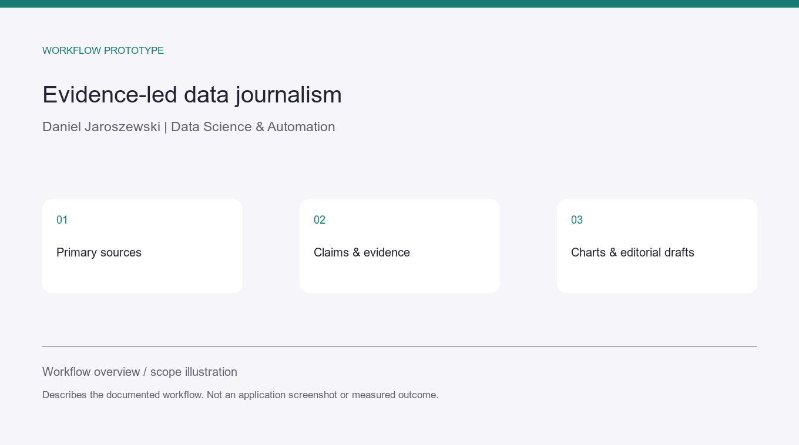

# Data Journalism — evidence-led research and visualisation

**Personal workflow prototype · primary sources · claims table · charts**

## Problem and intended workflow

A data story needs traceable claims before it becomes a chart or publication.
The repository defines a workflow from topic selection and research questions to
a claims-to-sources table, graphics and platform-specific editorial drafts.

Numbers and claims must map to primary-source evidence. Publishing is manual and
subject to human review.

## Current stage

The repository documentation marks the initial structure and conventions as prepared.
The end-to-end pilot story, rating bot and scheduled preference loop remain roadmap
items. This is a workflow prototype, not a completed publishing platform or client case.

## Relevant client application

Research an agreed question, organise source evidence and prepare a reviewable analysis
with charts. The private editorial material is not published here. The illustration
shows the proposed workflow and does not imply completed automation.
