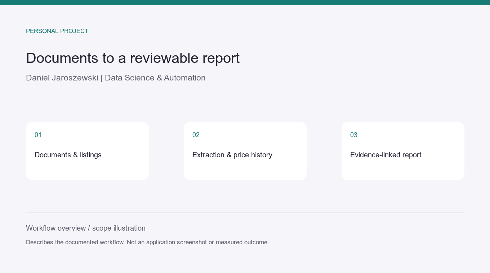

# Deal Hunter — document extraction and offer research

**Personal project · Python · SQLite · HTML/PDF/XLSX/DOCX**

## Problem and workflow

Offers and public notices can contain incomplete specifications, attachments and changing
prices. Deal Hunter preserves the source material, extracts native text and tables,
records price history and creates a review report with links back to the evidence.

The workflow keeps missing information, conflicting facts and source failures visible.
Document references retain page, row or table locations for review. Financial scenarios
use explicit assumptions and remain separate from observed asking prices.

## Relevant client application

Turn a specified set of documents and listings into structured records and a
reviewable report. A first milestone can cover one source, a defined field set and
traceable output, with acceptance checks on supplied examples.

## Evidence and limits

This is a summary of an existing private project, reviewed from its documentation.
The workflow illustration is not a screenshot or a measured client outcome.
Code, collected offers and private configuration are not published.

Native document extraction is supported; scanned documents require OCR/manual review
and this project's documented extraction workflow does not implement OCR.
Asking prices are not completed sales. No realised profit or investment performance
is claimed.
