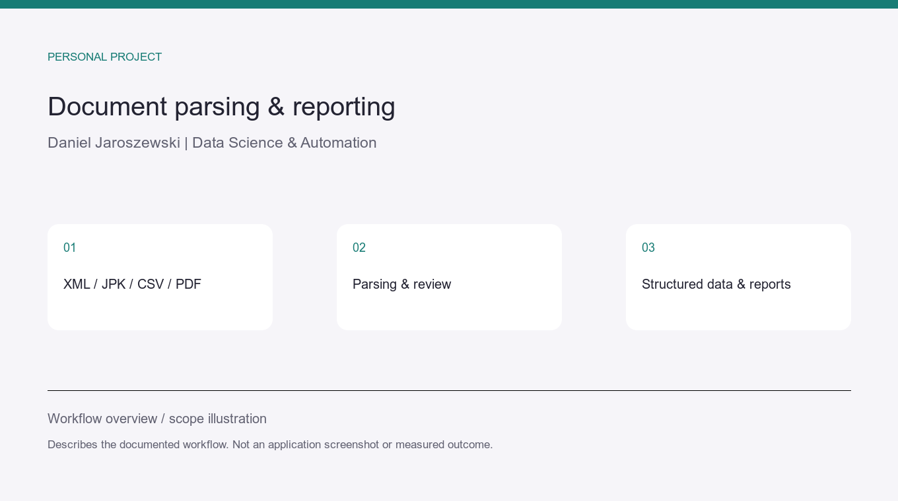

# ksiegowy-ai — document parsing and repeatable reports

**Personal project · Python · XML/JPK/CSV · local PDF OCR**

## Problem and workflow

Structured exports and document formats need consistent parsing before they can feed
a report. The public ksiegowy-ai project, extracted from the private JDG Assistant,
contains invoice XML, JPK and bank CSV parsers, reporting and local PDF OCR on macOS.

Calculations are performed by code. OCR transcripts and uncertain information require
review, and a person controls official submissions.

## Executed example and code

- [Public source code](https://github.com/ahZe667/ksiegowy-ai).
- [Existing CSV parser: input, executed output and verification](document-data.md).

The CSV example executes an existing parser on invented transactions. It does not
demonstrate extraction accuracy across arbitrary documents or scanned invoices.

## Relevant client application

Agree on a document/export format, expected fields and reconciliation checks, then
prepare structured output and a repeatable report with run instructions.

This is software and document-processing experience, not an accounting or tax-advisory
service. The illustration describes the workflow and is not a client-system screenshot.
