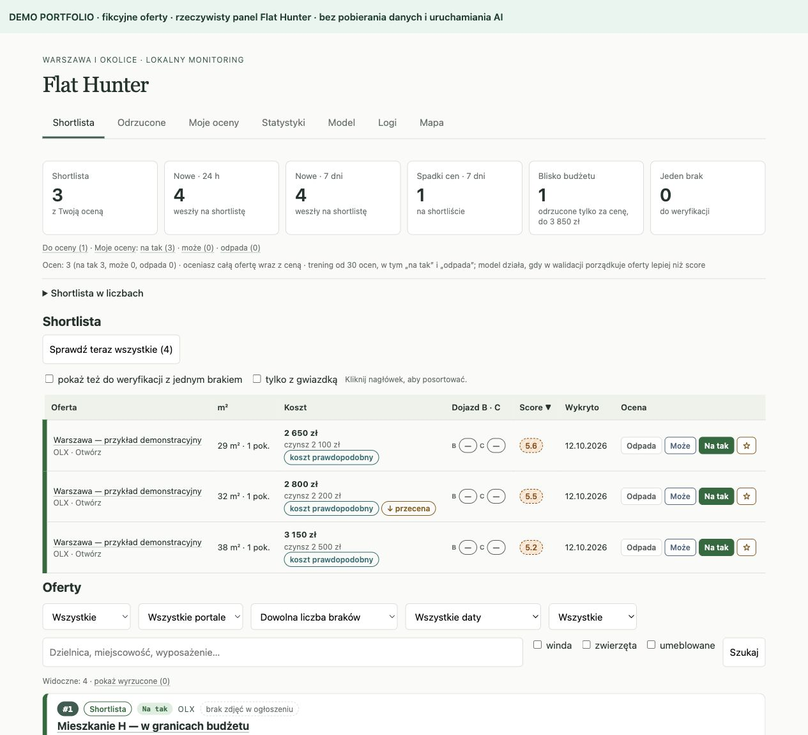
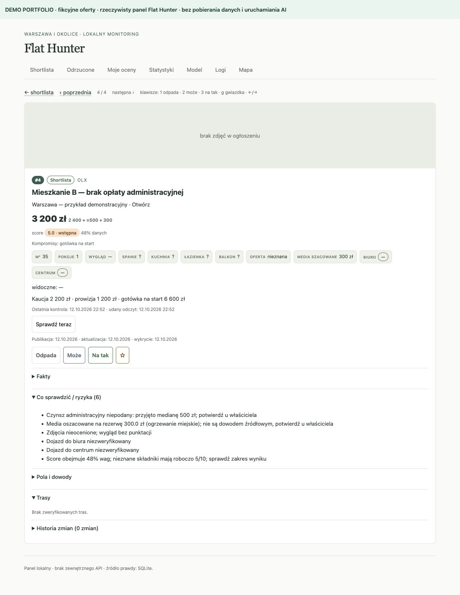

# Flat Hunter — collection, cost checks and a working research panel

**Personal project · Python · SQLite · APIs/HTTP · FastAPI · local AI**

**Po polsku:** narzędzie łączy oferty z kilku źródeł, zachowuje historię zmian,
porządkuje koszty i pokazuje informacje wymagające sprawdzenia. Poniżej jest
rzeczywisty interfejs aplikacji uruchomiony na fikcyjnych danych.

## The problem

Listing research involves overlapping sources, changing prices and incomplete costs.
A useful shortlist needs the source, calculation and uncertainty beside the result.

The existing application supports nine listing portals, normalizes records, retains
history in SQLite, checks duplicates and presents ranked results in a local web panel.
Local text and photo analysis can assist review. Source availability and model quality
remain separate checks; a failed source is not treated as an empty market.

## Executed demonstration

On 2026-10-12, the existing storage, qualification and web application were run with
eight invented listings in a separate database. No live listing, personal address,
contact detail or private capture was copied. Collection, routes and AI were disabled.

- Listing A: rent 2,200 + administration 400 + utilities 100–200 = **2,700–2,800 PLN**.
- Its invented earlier rent was 2,600; the application recorded a price decrease.
- Listing B has no stated administrative fee. The panel marks a **configured 500 PLN
  assumption** and asks the reviewer to confirm it; this is not a measured market median.
- Other examples exercise rejection for budget, area and inactive status.
- The user-review controls and filtering are the existing application interface.

The screenshot shows incomplete score coverage and unverified travel/photo information.
No recommendation accuracy, AI quality or client time saving is claimed by this demo.

## Application to client work

A similar workflow can combine agreed sources, retain changes, check data quality and
deliver a searchable shortlist or repeatable report. A first milestone can cover one
source, a stored snapshot and clearly defined checks. Access and collection rules,
duplicate policy, update frequency and delivery environment are agreed beforehand.

## Evidence and boundaries

The screenshots come from the working application, with a synthetic fixture and isolated
configuration. Source code and live data remain private. The nine-portal support comes
from the existing project documentation; this demo does not test live portal coverage.
Synthetic photo references were used, with no photo downloads or model evaluation.
