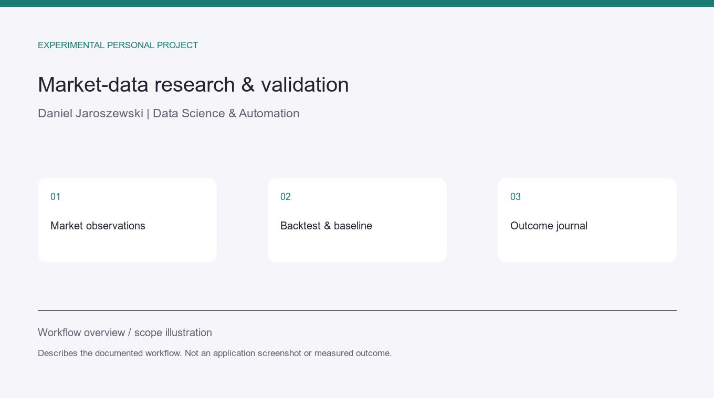

# Market-data research — backtesting and outcome tracking

**Personal experimental project · Python · data pipelines · validation**

## Research question and workflow

The private educational project connects market observations, a hypothesis/analysis
step, report generation, backtesting and an outcome journal.

Its documented evaluation compares results with a baseline and accounts for costs.
The distinction between an observation, a scenario and an evaluated outcome is explicit.

## Relevant client application

Prepare a repeatable research pipeline, record assumptions, compare a hypothesis with
a baseline and track outcomes. This demonstrates an analytical workflow rather than
an investment service.

## Evidence and limits

The project README was reviewed on 2026-10-22. It explicitly does not establish a
directional edge for the technical scan score. No investment effectiveness, profitable
strategy or realised return is claimed. The explanatory illustration contains no
account holdings, private financial data or live trading recommendation.
